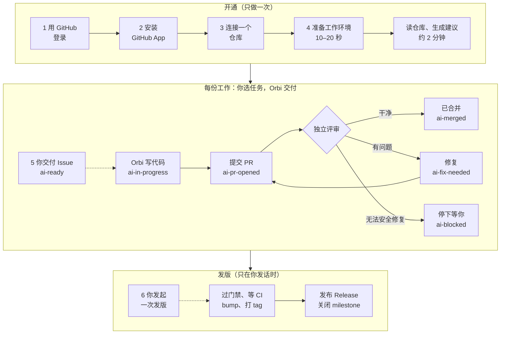
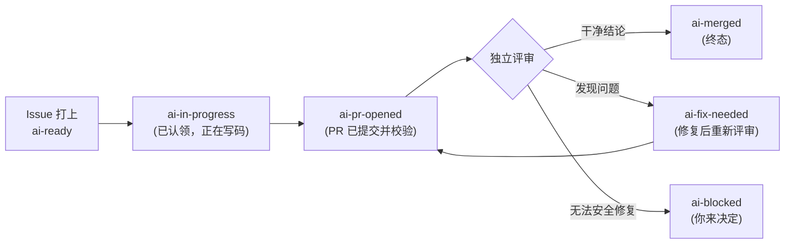

Orbi Cloud 是 Orbi 软件暗工厂（software dark factory）的托管版本：你定义目标和验收标准，Orbi 将 GitHub Issue 交付为经过实现、测试、独立评审、修复和合并的改动。基础设施由 Orbi 运维。

连接仓库后，Orbi 会读仓库，建议现在能做的事。新任务先「查看需求」，看过草稿再交给它；已有 Issue 可以点「让 Orbi 做这个」直接派发。你也可以自己「写需求」，或者在 GitHub 给 Issue 打上 `ai-ready`。Orbi 在隔离工作区完成交付，在评审和合并门禁通过后合并改动。Issue、PR 和发版证据都留在你的仓库里。

Orbi Cloud 跑的是和自托管 [Orbi](https://orbi.build/?ref=cloud-docs-index) 同一套交付引擎，引擎是开源的。区别只在于谁来运维 runner：用 Cloud，Orbi 来运维。

## 全流程

你授权并连接仓库，选择要做的任务，决定什么时候发版。准备工作环境和读仓库生成建议都会自动开始；确认交付后，Orbi 自动完成开发到合并。

由你决定开始哪个任务、什么时候发版。交付按钮会替你打上 `ai-ready`；读仓库或打开建议草稿都不会派发任务。

状态页用五步带你完成开通，最后一步是交出第一个需求。发版可以不做，前三次合并交付不需要订阅。也可以先[试官方示例](/zh/quickstart#先试官方示例)，不占这三次免费交付。

## 你实际要做的事

<CardGroup>
  <Card title="用 GitHub 登录" href="/zh/sign-in">
    一次 OAuth 点击。你的 GitHub 账号就是你的 Orbi 身份，没有单独的凭据。
  </Card>
  <Card title="安装 GitHub App" href="/zh/install-app">
    你来选 runner 可以在哪些仓库里工作，随时可以在 GitHub 上撤销。
  </Card>
  <Card title="连接一个仓库" href="/zh/connect-repository">
    选好仓库和基础分支。Orbi 为它准备工作环境，一般 10–20 秒。
  </Card>
  <Card title="给 Issue 打 `ai-ready`" href="/zh/first-issue">
    看过 Orbi 的建议草稿再交付、交给它已有的 Issue，或自己写需求。交付按钮会打上这个执行标签。
  </Card>
</CardGroup>

## 交付循环

评审由一个**没有写过这份代码**的会话执行。它修掉自己能修的问题并重跑测试；只有结论干净的 PR 才能进入合并门禁。当自动恢复不安全时，Issue 会落到 `ai-blocked` 并附一条说明原因的评论。这个状态是**有意的停止**，在等一个人的决定，不是崩溃。

每个标签的含义、以及什么会让 Issue 在它们之间移动，见[交付生命周期](/zh/delivery-lifecycle)。

## 价格

前 **3 次合并的交付免费**，不用绑卡，也不用订阅。失败的交付不消耗这个额度。

之后有两个付费档：**Solo** 和 **Pro**。两档的价格里都含模型用量：Solo 每月 4 亿（400,000,000）tokens、一个仓库；Pro 每月 12 亿（1,200,000,000）tokens、最多五个仓库。没有按 token 的超额计费：当月额度用完后，新的交付暂停，直到下个月，或者直到你配上自己的模型 key。

当前价格、按年付费的选项，以及正在进行的创始会员优惠，见[价格页](https://orbi.build/cloud/?ref=cloud-docs-index)。订阅怎么操作见[付费](/zh/billing)，额度怎么计见[额度与限制](/zh/limits-and-quotas)。

## Orbi Cloud 不做的事

它不会自己去发现仓库，只在你连接的仓库里工作。发版按你决定的版本和发布策略执行，通过带 `ai-ready` 与 `ai-release` 的 Issue 发起。普通代码改动通过评审后的 PR 进入基础分支；版本更新和空仓初始化有[明确的直接写入路径](/zh/security#orbi-会往你仓库里写什么)；平台升级时，它也不会打断一个正在执行的交付。

完整的边界清单，包括你的模型 key 存在哪、runner 能访问到什么，见[安全](/zh/security)。

头像菜单里的「设置」可以配置 [Telegram 通知和 Orbi 消息语言](/zh/notifications)，它们与网页界面的语言分开。

## 接下来读什么

想用最短路径拿到一个合并的 PR，从[快速开始](/zh/quickstart)。如果已经出问题了，去[问题排查](/zh/troubleshooting)。

## 引擎自己的文档

这些页面讲的是 Orbi Cloud 这个托管产品。底下那套交付引擎是开源的，文档单独放在 **[docs.orbi.build](https://docs.orbi.build/zh)**。想看机制而不是产品时去那边：

<CardGroup>
  <Card title="交付流程的完整机制" href="https://docs.orbi.build/zh/workflow">
    完整的标签状态机、评审与修复循环、转向、发版状态机。Cloud 替你跑的这一切，引擎侧的原始参考都在这里。
  </Card>
  <Card title="引擎的安全边界" href="https://docs.orbi.build/zh/security">
    引擎会做什么、不会做什么：它永远不推哪里、永远不合并什么，以及为什么。
  </Card>
  <Card title="改成自己跑" href="https://docs.orbi.build/zh/quickstart">
    自托管免费，并且一直免费。同一套引擎，runner 由你运维。
  </Card>
</CardGroup>
